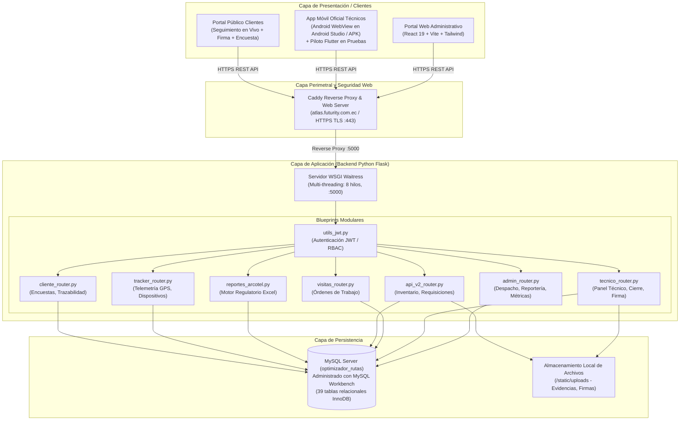

# INFORME TÉCNICO DE ARQUITECTURA Y ENTREGA DE SISTEMA
## PLATAFORMA ATLAS - GESTIÓN INTEGRAL DE OPERACIONES TÉCNICAS Y CUMPLIMIENTO REGULATORIO

---

**Empresa:** Futurity-Servicable  
**Sistema:** Atlas - Plataforma Operativa & Despacho Técnico  
**Dominio de Producción:** `atlas.futurity.com.ec`  
**Versión del Sistema:** 2.5 (Edición Producción)  
**Fecha de Emisión:** Octubre 2026  
**Estado:** Sistema en Producción / Alta Disponibilidad  
**Clasificación:** Documento Técnico Confidencial  

---

## 1. INTRODUCCIÓN Y CONTEXTO OPERATIVO

### 1.1. Contexto Empresarial
**Futurity-Servicable** opera como proveedor de servicios de internet y televisión por suscripción (ISP y Televisión por Cable) desplegando infraestructura híbrida de **Fibra Óptica (FTTH / GPON)** y redes de cable coaxial (**HFC**). La operación diaria requiere coordinar cuadrillas técnicas en campo, gestionar inventario de alta rotación en bodega central y vehículos, atender requerimientos y reclamos en call center, y cumplir rigurosamente con los marcos normativos exigidos por la **Agencia de Regulación y Control de las Telecomunicaciones (ARCOTEL)** de la República del Ecuador.

### 1.2. Justificación del Proyecto
Previo a la implementación de Atlas, la operación presentaba desafíos característicos de los operadores en crecimiento:
- Dispersión de información en hojas de cálculo no sincronizadas.
- Falta de trazabilidad en tiempo real sobre la ubicación y avance de los técnicos en campo.
- Dificultades para auditar el consumo real de materiales (conectores, fibra drop, splitters, cable RG6, equipos ONT/routers) por cada orden de trabajo.
- Tiempos elevados en la consolidación manual de información regulatoria mensual exigida por ARCOTEL, con riesgo de inconsistencias en formatos y fórmulas.

### 1.3. Propósito del Sistema Atlas
**Atlas** fue concebido y desarrollado como un ecosistema unificado, multiplataforma y centralizado que integra:
1. **Despacho y asignación inteligente** de visitas técnicas e instalaciones.
2. **Aplicación móvil para técnicos** con geolocalización, captura de evidencias fotográficas, firmas digitales y gestión de inventario rodante.
3. **Control estricto de bodega e inventario** con flujo digital de requisiciones y trazabilidad por número de serie y dirección MAC.
4. **Portal del cliente y auditoría de calidad** con encuestas de satisfacción inmediatas ("Momento de la Verdad").
5. **Módulo de telemetría y rastreo satelital (GPS Tracker)** de la flota vehicular.
6. **Motor regulatorio automatizado para ARCOTEL** con generación de anexos oficiales en Excel para tecnologías GPON, HFC y Reclamos de Velocidad.

---

## 2. OBJETIVOS DEL SISTEMA

### 2.1. Objetivo General
Diseñar, implementar y desplegar una plataforma informática integral y escalable que optimice el ciclo de vida completo de las órdenes técnicas en campo, garantice la trazabilidad de inventarios y activos de telecomunicaciones, y automatice la reportería operativa y regulatoria bajo estándares de calidad y alta disponibilidad.

### 2.2. Objetivos Específicos
1. **Digitalización Integral de Campo:** Proveer a las cuadrillas técnicas de una aplicación móvil oficial basada en WebView (desarrollada en Android Studio) y panel web responsivo para la consulta de rutas, registro de estados en tiempo real (En Camino, En Sitio, Finalizada), toma de fotografías obligatorias y firma digital del abonado (manteniendo en paralelo un piloto nativo en Flutter en fase de pruebas para futura evolución).
2. **Control y Auditoría de Materiales:** Implementar un modelo de doble verificación donde los materiales consumidos en cada visita debiten automáticamente el stock del vehículo/técnico y permitan auditorías comparativas frente al stock de bodega.
3. **Monitoreo Satelital en Tiempo Real:** Registrar la telemetría periódica de cuadrillas y vehículos para visualizar trayectorias, paradas y tiempos de permanencia en clientes mediante mapas geoespaciales.
4. **Automatización Regulatoria ARCOTEL:** Calcular de forma automática los tiempos de indisponibilidad de servicio en horas y minutos, filtrando averías por tecnología (GPON vs. HFC) y soluciones aplicadas, generando matrices oficiales sin intervención manual.
5. **Seguridad y Control de Acceso Basado en Roles (RBAC):** Restringir el acceso a la plataforma mediante tokens criptográficos JWT y perfiles estrictos (Administrador, Despacho, Auditor, Bodega, Técnico y Cliente).

---

## 3. ARQUITECTURA GLOBAL DEL SISTEMA

Atlas está estructurado bajo una **arquitectura cliente-servidor desacoplada (Decoupled Client-Server Architecture)**, orientada a microservicios lógicos mediante Blueprints modulares en el backend y aplicaciones frontend ricas (SPA Web y Aplicación Android de Campo) en la capa de presentación.



---

## 4. STACK TECNOLÓGICO Y VERSIONES

El sistema utiliza componentes de grado de producción seleccionados por su estabilidad, rendimiento concurrente y bajo consumo de recursos:

| Capa | Tecnología | Versión | Justificación Técnica |
| :--- | :--- | :--- | :--- |
| **Backend Core** | Python | 3.12+ | Lenguaje robusto para lógica de negocio, manipulación de datos y automatización. |
| **Web Framework** | Flask | 3.1.3 | Microframework de alta velocidad estructurado en Blueprints modulares independientes. |
| **Servidor WSGI** | Waitress | 3.0.1 | Servidor web multi-hilo nativo para entornos de producción en servidores Windows/Linux. |
| **Servidor Web y Proxy Inverso** | Caddy Server | 2.8+ | Servidor web y reverse proxy de cara a internet, gestiona el dominio oficial atlas.futurity.com.ec con aprovisionamiento y renovación automática de certificados SSL/TLS (HTTPS). |
| **Base de Datos** | MySQL Server / MySQL Workbench | 8.0+ | Motor de base de datos relacional con tablas InnoDB, administrado mediante MySQL Workbench y codificación UTF-8 Multibyte (`utf8mb4`). |
| **Frontend Web** | React | 19.2.8 | Biblioteca declarativa de componentes para interfaces interactivas de alta respuesta. |
| **Build Tool** | Vite | 8.2.0 | Empaquetador de aplicaciones web ultra rápido con recarga de módulos en caliente (HMR). |
| **Móvil Oficial Producción** | Android Studio / WebView | Android SDK 34 | Aplicación oficial de producción APK empaquetada como WebView optimizado con acceso a hardware (cámara, geolocalización). |
| **Móvil Piloto (Pruebas)** | Flutter / Dart | 3.24+ | Prototipo nativo en fase de validación y pruebas para futura evolución de la app técnica. |
| **Librería Mapas** | Leaflet / OpenStreetMap | 1.9+ | Renderizado de capas cartográficas y marcadores interactivos sin costos por API de terceros. |
| **OCR y Visión** | Tesseract.js & ZXing | 7.0 / 0.23 | Escaneo de códigos de barra/QR de equipos y reconocimiento óptico de números de serie con la cámara del celular. |
| **Procesamiento Datos**| pandas / openpyxl / numpy | 3.0 / 3.1 / 2.4 | Motor de cálculo analítico matricial y generación estricta de libros de cálculo Excel con estilos XML. |
| **Seguridad Token** | PyJWT | 2.13.0 | Generación y verificación criptográfica de tokens JSON Web Tokens (HMAC-SHA256). |

---

## 5. MÓDULOS FUNCIONALES DEL SISTEMA

### 5.1. Módulo de Despacho y Órdenes de Trabajo (`visitas_router.py` / `admin_router.py`)
- **Gestión del Ciclo de Vida de Visitas:** Creación, edición, reprogramación y cancelación de órdenes.
- **Estados Operativos:**
  - `PENDIENTE`: Orden registrada a la espera de cuadrilla.
  - `EN_CAMINO`: Técnico inició traslado hacia el abonado con registro de timestamp.
  - `EN_SITIO`: Técnico arribó al domicilio (captura de coordenadas GPS de inicio).
  - `FINALIZADA`: Trabajo ejecutado con reporte de materiales, fotos, solución y firma.
  - `CANCELADA` / `REPROGRAMADA`: Registro de justificación técnica u operativa.
- **Filtro de "Visitas del Día Siguiente":** Módulo inteligente que aísla averías reales excluyendo instalaciones nuevas para cálculo exacto de tiempos de atención preventiva y correctiva.
- **Gestión de Turnos y Bloqueos:** Programación de bloqueos de agenda por reuniones, capacitaciones, mantenimiento de vehículos o permisos de cuadrillas (`recordatorios_bloqueos`).

### 5.2. Módulo Móvil de Cuadrillas Técnicas (`tecnico_router.py` / App Oficial Android WebView & Piloto Flutter)
El personal técnico en campo opera mediante la **aplicación oficial Android en producción (desarrollada en Android Studio con WebView)**, la cual se integra fluidamente con el panel técnico responsivo de Atlas (`TecnicoPanel.jsx`) ofreciendo soporte táctil integral, captura de fotos y geolocalización. Paralelamente, se dispone de una aplicación nativa en **Flutter** (`futurity_mobile_test`) en fase de pruebas y evaluación para futura migración tecnológica. Sus capacidades principales incluyen:
- **Hoja de Ruta Digital:** Lista de visitas ordenadas por prioridad geográfica y franja horaria.
- **Check-in Georreferenciado:** Verificación obligatoria de coordenadas GPS (`latitud_inicio`, `longitud_inicio`, `latitud`, `longitud`) para garantizar que la visita se realizó en el domicilio real del suscriptor.
- **Captura Fotográfica de Evidencias:**
  - Foto obligatoria de equipos instalados (ONT / Router / Deco).
  - Foto de roseta óptica / acoplador / splitters.
  - Fotografías extras opcionales (hasta 4 capturas para registrar acometidas complejas o daños en fibra).
- **Consumo de Materiales en Sitio:** Selección de insumos utilizados (conectores mecánicos SC/APC, cable drop, splitters, etc.), descontándose inmediatamente del stock asignado a la buseta.
- **Firma Digital del Cliente:** Captura de firma manuscrita sobre pantalla táctil mediante canvas interactivo, almacenada en formato SVG/PNG con estampa de tiempo.
- **Botón de Pánico y Alerta SOS:** Funcionalidad de seguridad física que emite una señal de socorro geolocalizada inmediata al centro de monitoreo ante situaciones de riesgo en campo.

### 5.3. Módulo de Bodega, Inventarios y Requisiciones (`api_v2_router.py` / `EquiposBodegaTab.jsx`)
- **Catálogo Oficial Estandarizado:** 44 códigos únicos de materiales clasificados por categorías (`CABLES`, `CONECTORES`, `SPLITTERS`, `CAJAS`, `HERRAMIENTAS`, `ELECTRICIDAD`, `ACCESORIOS`).
- **Flujo Digital de Requisiciones:**
  1. Técnico solicita materiales requeridos para su jornada desde la app.
  2. Bodeguero valida y aprueba la entrega en bodega central.
  3. Firma digital de recepción por parte del técnico responsable.
  4. Traspaso automático de stock desde bodega central hacia el inventario del vehículo (`inventario_tecnicos`).
- **Trazabilidad de Equipos Terminales:** Registro individualizado de ONTs y routers por número de serie, dirección MAC, estado (Nuevo, Recuperado, Dañado) y cliente asociado (`trazabilidad_equipos`).

### 5.4. Módulo de Auditoría de Calidad y Atención al Cliente (`AuditoriaVisitasTab.jsx` / `EncuestaCliente.jsx`)
- **Auditoría Post-Servicio:** Supervisión por parte de personal de calidad verificando fotos de la visita, lectura de potencias ópticas y coherencia entre el problema reportado y la solución registrada.
- **Encuesta "Momento de la Verdad" (Norma ARCOTEL):**
  - Trato del personal técnico (Escala 1 a 5).
  - Paciencia y claridad en la explicación.
  - Disponibilidad del servicio tras la visita.
  - Agilidad de resolución.
  - Tiempo de espera percibido y sugerencias abiertas.
- **Trazabilidad Pública para el Cliente:** Enlace web temporal enviado por SMS/WhatsApp donde el cliente visualiza la foto del técnico asignado, la placa del vehículo, el tiempo estimado de llegada y la opción de firmar remotamente.

### 5.5. Módulo de Telemetría y Rastreo Satelital (`tracker_router.py` / `MapaTrackerTab.jsx`)
- **Ingesta de Posiciones GPS:** Recepción periódica de paquetes de telemetría (latitud, longitud, velocidad, rumbo, nivel de batería, estado de conexión).
- **Visualización en Mapa:** Capa interactiva sobre Leaflet con marcadores dinámicos que muestran el estado de las cuadrillas (En movimiento, Detenido, En cliente, Fuera de servicio).
- **Historial de Rutas:** Reproducción de recorridos históricos de cada vehículo para auditoría de kilometraje y cumplimiento de zonas asignadas.

---

## 6. MÓDULO REGULATORIO ESPECIALIZADO ARCOTEL

El motor regulatorio desarrollado en [`reportes_arcotel.py`](file:///c:/Users/Operaciones/Documents/Futurity/futurity/reportes_arcotel.py) automatiza la generación de las tres matrices oficiales requeridas periódicamente por el ente regulador ecuatoriano:

### 6.1. Formulario GPON: Tiempo Promedio de Reparación de Averías
- **Normativa:** Control de indisponibilidad técnica en redes de fibra óptica.
- **Estructura:** Matriz de 11 columnas institucionales con cabecera oficial de ARCOTEL:
  1. *Número de Reclamo:* Identificador único de orden/atención.
  2. *Código de Abonado:* Código identificador del cliente en el sistema.
  3. *Nombre del Suscriptor:* Razón social o nombres completos.
  4. *Teléfono:* Normalizado a formato celular ecuatoriano (10 dígitos).
  5. *Provincia:* Localización territorial.
  6. *Cantón:* Jurisdicción cantonal.
  7. *Parroquia:* División parroquial.
  8. *Fecha/Hora Reporte:* Formato estricto `d/m/yyyy h:mm`.
  9. *Fecha/Hora Solución:* Formato estricto `d/m/yyyy h:mm`.
  10. *Duración de la Interrupción (Horas):* Fórmula nativa de Excel `=I{row}-H{row}` con formato horario `[h]:mm:ss`.
  11. *Solución / Causa:* Estandarizada según catálogo validado por ARCOTEL (ej. `CAMBIO DE CONECTORES APC/UPC`, `COLOCACION DE UNION`, `REPARACION DE FIBRA`).
- **Filtros Especiales Aplicados:**
  - Inclusión exclusiva de averías técnicas reales en fibra.
  - Homologación automática de variantes operativas (ej. `"REVISIÓN EN DAÑO DE FIBRA + CAMBIO DE CONECTORES"` se unifica bajo el término homologado de reporte).

### 6.2. Formulario HFC: Formulario SAV-Q-001 (Requerimientos de Atención)
- **Normativa:** Control de calidad para el servicio de Audio y Video por Suscripción (Televisión por Cable Coaxial).
- **Estructura:** Formato oficial de 8 columnas:
  - *Número de Requerimiento, Identificación del Suscriptor, Nombre, Dirección, Teléfono, Fecha y Hora de Ingreso, Fecha y Hora de Solución, Tipo de Requerimiento / Solución.*
- **Filtro de Exclusión Tecnológica:**
  - Análisis algorítmico del paquete del cliente para diferenciar suscriptores de cable tradicional coaxial (HFC) de usuarios con televisión transmitida sobre fibra (Cable GPON / IPTV), garantizando que solo ingresen averías imputables al título habilitante de televisión por cable.

### 6.3. Formulario VELOCIDAD: Porcentaje de Reclamos por Capacidad del Canal de Acceso
- **Normativa:** Evaluación de reclamos vinculados a degradación de ancho de banda o incumplimiento de velocidad contratada.
- **Estructura:** Matriz de 10 columnas que incluye la capacidad contratada expresada en Kbps (`extract_speed_kbps`), fechas y tiempos de restitución del caudal de datos.
- **Criterio de Inclusión:**
  - Problema reportado exclusivamente: `NO MARCA VELOCIDAD CONTRATADA`.
  - Soluciones técnicas validadas: `CAMBIO DE CONECTORES RJ45` y `CAMBIO DE ONT`.

---

## 7. MODELO Y DICCIONARIO DE BASE DE DATOS

El esquema relacional opera sobre el motor **InnoDB** en la base de datos `optimizador_rutas` alojada en **MySQL Server**, administrada integralmente a través de **MySQL Workbench**. A continuación se detallan las tablas nucleares del sistema:

### 7.1. Tabla `visitas_tecnicas` (Entidad Principal de Operación)
| Columna | Tipo de Dato | Nulable | Descripción |
| :--- | :--- | :--- | :--- |
| `id_visita` | INT (PK, Auto) | No | Clave primaria única de la orden de trabajo. |
| `cliente_id` / `codigo_cliente`| VARCHAR(50) | Sí | Identificador del abonado en el sistema comercial. |
| `nombre_cliente` | VARCHAR(150) | No | Nombre o razón social del cliente. |
| `direccion` | TEXT | No | Dirección detallada del domicilio del cliente. |
| `telefono` | VARCHAR(50) | Sí | Teléfono fijo o móvil de contacto. |
| `sector` | VARCHAR(100) | Sí | Zona geográfica o nodo de red asignado. |
| `tecnico_id` | INT (FK) | Sí | Referencia a la tabla `tecnicos`. |
| `estado` | ENUM | No | `PENDIENTE`, `EN_CAMINO`, `EN_SITIO`, `FINALIZADA`, `CANCELADA`. |
| `problema` | VARCHAR(255) | Sí | Causa inicial de la visita reportada por call center. |
| `solucion` | VARCHAR(255) | Sí | Diagnóstico y trabajo técnico ejecutado en sitio. |
| `fecha_programada` | DATE | No | Fecha en la que debe ejecutarse la visita. |
| `hora_ingreso` | DATETIME | Sí | Momento en el que el cliente generó el reporte. |
| `hora_solucion` | DATETIME | Sí | Momento en el que el técnico cerró la orden. |
| `latitud` / `longitud` | DOUBLE | Sí | Coordenadas GPS en el momento del cierre de la orden. |
| `latitud_inicio` / `longitud_inicio`| DOUBLE | Sí | Coordenadas GPS al llegar al sitio del cliente. |
| `foto_equipos` / `foto_equipos_2` | VARCHAR(255) | Sí | Rutas relativas a las fotos de validación de equipos. |
| `foto_extra_1` a `foto_extra_4` | VARCHAR(255) | Sí | Rutas a fotos adicionales de evidencia técnica. |
| `firma_cliente` | VARCHAR(255) | Sí | Ruta al archivo con la firma manuscrita digitalizada. |
| `es_instalacion` | TINYINT(1) | Sí | Indicador para separar instalaciones nuevas de averías. |
| `arcotel_p1_trato` a `arcotel_p5`| INT | Sí | Resultados de la encuesta de satisfacción ARCOTEL. |

### 7.2. Tabla `materiales` (Catálogo Central de Insumos)
| Columna | Tipo de Dato | Nulable | Descripción |
| :--- | :--- | :--- | :--- |
| `id_material` | INT (PK, Auto) | No | Clave primaria del material. |
| `codigo_material` | VARCHAR(50) | Sí | Código alfanumérico institucional (ej. `CON0008V`). |
| `nombre_material` | VARCHAR(255) | No | Descripción técnica oficial del ítem. |
| `unidad_medida` | VARCHAR(50) | No | `UNIDADES`, `METROS`, etc. |
| `categoria` | VARCHAR(50) | No | `CABLES`, `CONECTORES`, `SPLITTERS`, `HERRAMIENTAS`, etc. |
| `stock_bodega` | INT | No | Saldo actual disponible en bodega central. |
| `stock_minimo` | INT | No | Punto de reorden para alertas de compra. |
| `activo` | TINYINT(1) | No | Estado lógico del ítem en catálogo (1: Activo, 0: Inactivo). |

### 7.3. Tabla `inventario_tecnicos` (Stock Rodante en Cuadrillas)
| Columna | Tipo de Dato | Nulable | Descripción |
| :--- | :--- | :--- | :--- |
| `id_inventario` | INT (PK, Auto) | No | Clave primaria. |
| `tecnico_id` | INT (FK) | No | Cuadrilla o técnico custodio del material. |
| `material_id` | INT (FK) | No | Material asignado. |
| `cantidad` | DECIMAL(10,2) | No | Cantidad física disponible dentro del vehículo. |

### 7.4. Tabla `trazabilidad_equipos` (Control de ONTs y Decodificadores)
| Columna | Tipo de Dato | Nulable | Descripción |
| :--- | :--- | :--- | :--- |
| `id_trazabilidad` | INT (PK, Auto) | No | Identificador del movimiento del equipo. |
| `serie` | VARCHAR(100) | No | Número de serie físico escaneado por OCR/código de barras. |
| `mac` | VARCHAR(50) | Sí | Dirección MAC del hardware. |
| `modelo` | VARCHAR(100) | Sí | Referencia del fabricante (Huawei, ZTE, Fiberhome). |
| `estado` | VARCHAR(50) | No | `EN_BODEGA`, `ASIGNADO_TECNICO`, `INSTALADO_CLIENTE`, `DEFECTUOSO`. |
| `tecnico_id` | INT (FK) | Sí | Custodio actual o técnico que retiró el equipo. |
| `cliente_id` | VARCHAR(50) | Sí | Abonado donde se encuentra instalado. |

### 7.5. Tablas de Telemetría GPS (`tracker_devices` y `tracker_location_records`)
- `tracker_devices`: Almacena el identificador único del hardware/teléfono rastreador, placa del vehículo asociado y técnico responsable.
- `tracker_location_records`: Registra el flujo masivo de posiciones con timestamp UTC, latitud, longitud, altitud, precisión, velocidad y estado de batería.

---

## 8. SEGURIDAD, AUTENTICACIÓN Y POLÍTICAS DE ACCESO

### 8.1. Mecanismo de Autenticación Stateless (JWT)
El sistema utiliza JSON Web Tokens firmados criptográficamente mediante algoritmo **HS256** administrado en [`utils_jwt.py`](file:///c:/Users/Operaciones/Documents/Futurity/futurity/utils_jwt.py):
- **Carga Útil (Payload):** Contiene el identificador del usuario, rol de acceso, nombre y una firma temporal única `session_token`.
- **Expiración de Sesión:** Tiempo de vida configurable (8 a 24 horas continuas de operación).
- **Control de Sesión Única:** Se implementó una verificación activa contra la columna `session_token` en la base de datos para impedir que una misma cuenta sea utilizada simultáneamente en múltiples dispositivos, mitigando el robo de credenciales.

### 8.2. Control de Acceso Basado en Roles (RBAC)
Cada endpoint en los Blueprints del backend valida estrictamente la presencia del rol adecuado mediante decoradores:
1. **Administrador (`admin`):** Acceso irrestricto a todas las funciones, configuración del sistema, creación de usuarios, reportes gerenciales y módulo ARCOTEL.
2. **Despachador (`despacho` / `callcenter`):** Creación y programación de visitas, asignación de técnicos, consulta de clientes y seguimiento de estados.
3. **Auditor (`auditoria`):** Revisión de calidad de visitas, validación de consumos y revisión fotográfica.
4. **Bodeguero (`bodega`):** Recepción de compras, despacho de requisiciones, control de series y movimientos de almacén.
5. **Técnico (`tecnico`):** Acceso acotado exclusivamente a sus órdenes asignadas, registro de consumos, toma de fotografías y su propio stock rodante.
6. **Cliente (Acceso Público Tokenizado):** Enlace efímero con token URL de un solo uso para firma digital y llenado de encuesta de satisfacción.

### 8.3. Sanitización y Protección de Datos
- **Consultas Parametrizadas:** Todo el código SQL utiliza tuplas de parámetros vinculados (`%s`), previniendo vulnerabilidades de inyección SQL (SQLi).
- **Subida de Archivos Protegida:** Validación de extensiones permitidas (`.png`, `.jpg`, `.jpeg`), almacenamiento con nombres únicos basados en UUID y sanitización de rutas para evitar Directory Traversal.
- **Protección CORS:** Configuración estricta en Flask-CORS permitiendo únicamente peticiones originadas desde los dominios autorizados de la empresa.

---

## 9. INFRAESTRUCTURA, DESPLIEGUE Y OPERACIÓN CONTINUA

### 9.1. Topología del Servidor de Producción
El sistema se encuentra desplegado en un entorno de servidor dedicado bajo el sistema operativo **Windows Server / Windows 11 Pro**:

```
[ Internet / Clientes y Técnicos ]
          │
          ▼ (HTTPS Puerto 443 / atlas.futurity.com.ec)
[ Caddy Reverse Proxy (Certificados TLS / HTTPS Automático) ]
          │
          ▼ (HTTP Local 127.0.0.1:5000)
[ Servidor WSGI Waitress (Multi-hilo / 8 workers) ]
          │
          ▼
[ Aplicación Flask Modular (Atlas Core) ]
          │
   ┌──────┴──────────────────────────┐
   ▼                                 ▼
[ MySQL Server (optimizador_rutas) ] [ Sistema de Archivos (/static/uploads) ]
(Gestión vía MySQL Workbench)         (Fotos de evidencia y firmas)
```

### 9.2. Mecanismo de Ejecución Invisible (Daemon Background)
Para evitar que cierres accidentales de consolas interrumpan el servicio, el arranque en segundo plano está gestionado mediante el script VBScript [`iniciar_servicios_segundo_plano.vbs`](file:///c:/Users/Operaciones/Documents/Futurity/futurity/iniciar_servicios_segundo_plano.vbs), el cual levanta:
1. **`run_prod.bat` / `run_prod.py`:** Inicializa Waitress en el puerto `5000`, incorporando una rutina previa que libera automáticamente el puerto ante cierres abruptos anteriores (`liberar_puerto`).
2. **`run_caddy.bat`:** Ejecuta el proxy inverso Caddy para administrar el dominio `atlas.futurity.com.ec` y proveer cifrado HTTPS con certificados TLS válidos.

### 9.3. Política de Respaldo Automatizado (`backup_manager.py`)
- **Frecuencia:** Copia de seguridad completa diaria ejecutada de forma desatendida.
- **Mecanismo:** Extracción de dump estructurado vía `mysqldump`, compresión gzip y almacenamiento en el directorio seguro `/backups/`.
- **Retención:** Política de rotación automática para mantener los últimos 30 respaldos, depurando archivos antiguos para garantizar espacio en disco.

---

## 10. MÉTRICAS DE IMPACTO Y RESULTADOS OPERACIONALES

Tras el despliegue del sistema Atlas en producción, se registran los siguientes beneficios cuantitativos y cualitativos:

| Indicador Operativo | Estado Previo | Con Plataforma Atlas | Impacto / Mejora |
| :--- | :--- | :--- | :--- |
| **Tiempo de Elaboración Reportes ARCOTEL** | 4 a 6 días laborables | **< 30 segundos** (Descarga directa en 1 clic) | Reducción del **99%** en tiempo de consolidación. |
| **Trazabilidad de Órdenes en Tiempo Real** | 0% (Vía llamadas telefónicas) | **100% geolocalizado** con estampa de tiempo | Visibilidad total de la flota técnica. |
| **Pérdida / Desvío de Materiales en Campo** | Alta incertidumbre | **Auditoría cruzada** visita vs. vehículo vs. bodega | Control total de inventario y costos. |
| **Actas de Entrega y Conformidad** | Hojas físicas impresas (riesgo de extravío) | **Firma digitalizada** almacenada permanentemente | Cero consumo de papel y disponibilidad inmediata. |
| **Tasa de Auditoría Fotográfica** | Muestreo manual < 10% | **100% de visitas con fotos obligatorias** | Incremento sustancial en calidad de instalaciones. |

---

## 11. CONCLUSIONES Y RECOMENDACIONES

### 11.1. Conclusiones
1. **Atlas** ha consolidado con éxito la transformación digital de la operación técnica de **Futurity-Servicable**, sustituyendo procesos manuales dispersos por una arquitectura robusta, escalable y auditada.
2. El motor regulatorio implementado elimina completamente el error humano en los cálculos de indisponibilidad y en el formateo exigido por **ARCOTEL**, blindando a la empresa ante posibles observaciones normativas.
3. La combinación de una aplicación web ágil (React 19) con el aplicativo móvil oficial en Android Studio (WebView optimizado) ha incrementado la productividad de las cuadrillas técnicas y ha elevado la percepción de calidad del servicio por parte del abonado final.

### 11.2. Recomendaciones de Evolución Futura
1. **Optimización Algorítmica de Despacho (Ruteo VRP):** Incorporar un motor de optimización matemática para el Problema de Enrutamiento de Vehículos (VRP) que asigne automáticamente las rutas a cada cuadrilla minimizando tiempos de traslado y consumo de combustible.
2. **Consolidación de la App Nativa Flutter:** Concluir la fase de pruebas y pilotaje de la aplicación nativa en Flutter para planificar una transición gradual desde el WebView actual hacia el aplicativo 100% nativo.
3. **Módulo Predictivo de Mantenimiento de Flota:** Aprovechar la telemetría del módulo tracker para alertar sobre cambios de aceite, mantenimientos preventivos y desgaste de neumáticos de los vehículos de las cuadrillas.

---

**Elaborado y Aprobado por:**  
*Equipo de Ingeniería de Software y Operaciones Técnicas*  
**Futurity-Servicable**
